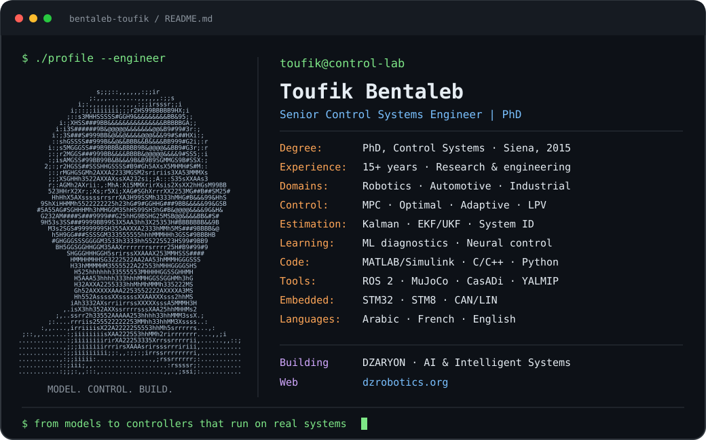

<picture>
  <source media="(max-width: 600px)" srcset="./assets/profile-mobile.svg">
  
</picture>

  <a href="https://dzrobotics.org"><strong>DZARYON</strong></a>
  &nbsp; / &nbsp;
  <a href="https://dzrobotics.org/propose">Propose a project</a>
  &nbsp; / &nbsp;
  <a href="https://github.com/bentaleb-toufik?tab=repositories">Repositories</a>
  &nbsp; / &nbsp;
  <a href="./assets/portrait.txt">ASCII portrait (.txt)</a>

I develop control and estimation algorithms for systems that move, sense and interact with the physical world. My work connects dynamic modelling, simulation and optimization with embedded implementation and validation.

PhD in Control Systems, **University of Siena (2015)**. Experience across academic research and industrial engineering in robotics, vehicle dynamics, embedded systems and automation.

### Engineering focus

| Area | Methods and practice |
| :--- | :--- |
| **Control & optimization** | Linear and nonlinear MPC, optimal control, LPV systems, adaptive control, PID and control allocation |
| **Modelling & estimation** | Dynamic modelling, system identification, Kalman filtering, EKF/UKF and observers |
| **Learning & diagnostics** | Neural models, residual learning, regression and calibrable diagnostic algorithms |
| **Embedded systems** | MATLAB/Simulink, C/C++, Python, STM32/STM8, CAN/LIN, integration and verification |
| **Robotics & simulation** | ROS 2, MuJoCo, trajectory optimization and controller prototyping |
| **Systems engineering** | Requirements, architecture, traceability, ASPICE and verification & validation |

### What I am building

- **[DZARYON](https://dzrobotics.org)** — a community initiative connecting students, researchers, engineers and makers around AI and intelligent systems. We build skills, test ideas in simulation and work toward physical prototypes.
- **Robotics simulation** — modelling robot dynamics and prototyping control and estimation methods with MuJoCo and ROS 2.
- **Learning-assisted control** — exploring how data-driven models can complement established controllers under real-world constraints.

### How I work

**Understand the physics → Build the model → Test the controller → Implement → Validate.**

I welcome collaboration on control, robotics, embedded intelligence and practical research projects. **[Share an idea with DZARYON →](https://dzrobotics.org/propose)**

---

نبني الكفاءات ثم الآلات · Build skills, then machines.

